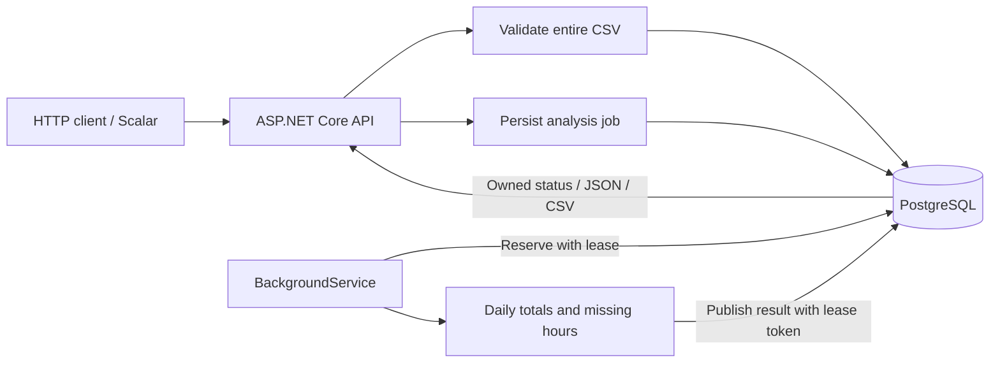

# MeterFlow

MeterFlow imports hourly building-energy readings, checks their quality, and runs daily consumption analysis in the background. It answers two separate questions: **how much energy was measured, and which hours are missing?** Zero consumption is a valid reading; missing consumption is never silently replaced with zero.

This is a small C# backend portfolio project: one ASP.NET Core API, one hosted worker, and PostgreSQL for users, measurements, durable jobs and results. No AI models, paid services or cloud account are required.



## Run the complete demo

Prerequisites: Docker with Compose v2, Python 3, and Git. The API binds to localhost; PostgreSQL stays inside the Compose network.

```sh
git clone https://github.com/gnanavelsander/meterflow.git
cd meterflow
cp .env.example .env
python3 -c 'import pathlib,secrets; pathlib.Path(".env").write_text("POSTGRES_PASSWORD=" + secrets.token_hex(24) + "\n")'
docker compose up --build -d
curl --fail http://localhost:8080/health/ready
python3 scripts/demo.py
```

Wait until the health endpoint responds successfully before running the script. The password command initializes a **new checkout**; keep the same `.env` when reusing the database volume. The file is ignored by Git.

Open [Scalar API reference](http://localhost:8080/scalar/v1) to send requests interactively, or run [the HTTP request collection](examples/meterflow.http) in a compatible editor. [The walkthrough](docs/demo.md) explains registration, bearer authentication, CSV upload, job polling and download.

The script creates a synthetic account and project, verifies an invalid import is rejected, imports 26 readings, checks idempotency, and compares the result against [known answers](samples/expected-summary.json). It saves JSON and CSV in the ignored `artifacts/` directory. Building A has **23 kWh** and B **2.5 kWh** on January 1; January 2 has no readings and returns `null` consumption. Each run creates fresh demo resources.

```sh
docker compose down                 # Stop; retain database and token-key volumes
# Optional: test that existing tokens and results survive an API restart
# Start the stack again first if it is stopped:
docker compose up -d
python3 scripts/demo.py --verify-restart
```

## Find your way around

| Location | Responsibility |
| --- | --- |
| [Program.cs](src/MeterFlow.Api/Program.cs) | Authentication, DI, error handling, routes and worker startup |
| [Projects](src/MeterFlow.Api/Projects/ProjectEndpoints.cs) | Owner-scoped project creation and search |
| [Datasets](src/MeterFlow.Api/Datasets/CsvImport.cs) | CSV validation and transactional import |
| [Jobs](src/MeterFlow.Api/Jobs/JobQueue.cs) | Durable reservations, retries and fenced result publication |
| [Analysis](src/MeterFlow.Api/Analysis/AnalysisCalculator.cs) | Pure daily calculations and missing-hour detection |
| [Data](src/MeterFlow.Api/Data/AppDbContext.cs) | EF mappings, indexes and committed migrations |
| [Tests](tests/MeterFlow.Tests) | Unit tests and real PostgreSQL integration tests |
| [Samples](samples) / [scripts](scripts/demo.py) | Synthetic input, known answers and executable demonstration |

Recommended reading: **[code guide](docs/code-guide.md)** → [CSV rules](docs/data-contract.md) → [job lifecycle and architecture](docs/architecture.md) → [testing](docs/testing.md). The code guide includes interview questions tied to actual implementation choices.

## Build and test

Install the .NET 10 SDK selected by [global.json](global.json). Docker must be running for integration tests; Testcontainers starts PostgreSQL automatically.

```sh
dotnet restore --locked-mode
dotnet build -c Release --no-restore
dotnet test -c Release --no-build
# Unit tests only, without Docker:
dotnet test -c Release --filter 'Category!=Integration'
```

[GitHub Actions](https://github.com/gnanavelsander/meterflow/actions/workflows/ci.yml) builds the solution, runs the tests against real PostgreSQL, builds the container image and exercises the Compose demo. See [verification and limitations](docs/testing.md) for what is checked and what is outside this version.

The scope is deliberately bounded: immutable datasets, at most 5 MiB / 50,000 rows / 100 buildings per import, and 1–31 UTC days per analysis. There is no prediction, organisation administration or public write-enabled deployment. Identity email delivery, retention/deletion, production secret storage and operational monitoring need further work before a public deployment.
