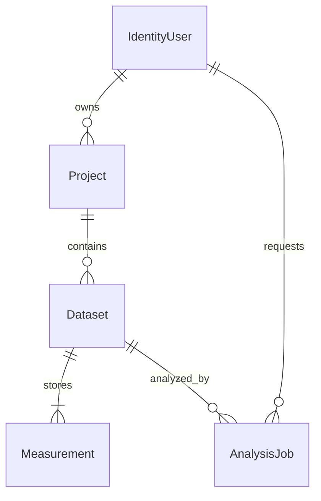
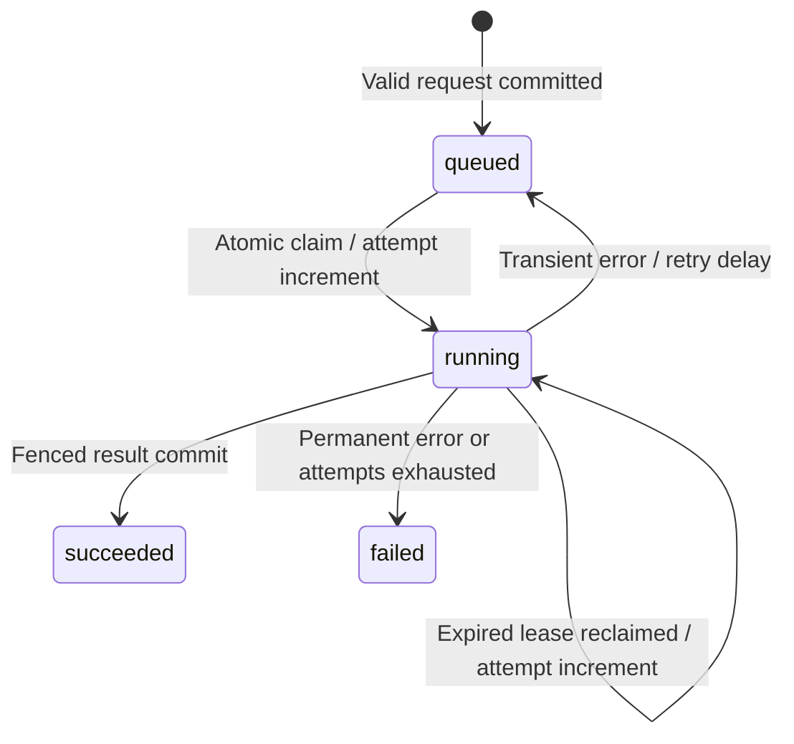

# Architecture and reliability

## One application, one database

[Program.cs](../src/MeterFlow.Api/Program.cs) hosts HTTP endpoints and an `AnalysisWorker : BackgroundService` in one process. ASP.NET Core supplies routing, authentication, dependency injection, logging and Problem Details. PostgreSQL holds both business data and the work queue, so restarting the process does not discard accepted jobs. This version has no broker or separate worker deployment.

EF Core and the Npgsql provider map projects, datasets, measurements and jobs to PostgreSQL. Regular owner-filtered queries and atomic imports use EF. [JobQueue](../src/MeterFlow.Api/Jobs/JobQueue.cs) uses parameterized PostgreSQL SQL where row-lock and lease semantics need to be explicit. CsvHelper handles CSV syntax; domain validation stays in `CsvImport`. Scalar renders the generated OpenAPI document and provides a local request interface.

These are practical roles in this implementation, not claims that competing frameworks were benchmarked. [.NET 10 is an LTS release](https://dotnet.microsoft.com/en-us/platform/support/policy/dotnet-core), and [Npgsql's EF Core 10 provider](https://www.npgsql.org/efcore/release-notes/10.0.html) matches the selected EF version. NuGet lock files make restores repeatable; updates still require testing.

## Data model

See [AppDbContext.OnModelCreating](../src/MeterFlow.Api/Data/AppDbContext.cs) and [migrations](../src/MeterFlow.Api/Data/Migrations). Datasets are immutable through the API. Job request settings and result JSON are on the same job row. The unique `(OwnerId, IdempotencyKey)` index resolves races between submissions; `(DatasetId, BuildingId, Timestamp)` prevents duplicate measurements. Project/dataset timestamps and job status indexes support common list/queue queries.

## Ownership and authentication

ASP.NET Core Identity owns password hashing, registration, sign-in, lockout and token issuance. The mapped `/auth/register`, `/auth/login` and `/auth/refresh` routes use the [built-in Identity API](https://learn.microsoft.com/en-us/aspnet/core/security/authentication/identity-api-authorization?view=aspnetcore-10.0). Access tokens are opaque protected tokens, **not JWTs**. The project does not implement cryptography or a token protocol.

Resource endpoints under `/api` explicitly require the Identity bearer scheme. They derive the owner from the authenticated `NameIdentifier` claim; request payloads never choose an owner. Project access filters by `OwnerId`; dataset access follows its project's owner; job/result access filters by the owner recorded at submission. A missing resource and someone else's resource both return 404. Missing authentication returns 401. Tests exercise these boundaries, including CSV exports.

Data Protection keys are persisted in a separate Compose volume so tokens continue working across API restarts. Local development keys are ignored by Git and excluded from Docker builds. Keys in the local volume are not encrypted at rest. Identity email confirmation/recovery delivery is not configured, and no public Identity service or external identity provider is deployed.

## Job state machine

1. `JobEndpoints.MapJobs` validates ownership, key and date range **before returning 202**. SHA-256 covers a canonical dataset ID, date range and analysis version. Matching key and hash return the existing job; different settings return 409. Concurrent inserts are resolved by the database's unique index and a reload.
2. `JobQueue.Claim` selects one eligible row using `FOR UPDATE SKIP LOCKED` and updates it inside the same SQL statement. It sets a new random lease token, a 30-second expiry and increments attempts. Multiple application instances can compete without holding valid reservations for the same job.
3. `AnalysisWorker` renews the lease every 10 seconds using a separate DI scope/DbContext. Processing uses a cancellation token. Loss of a lease or renewal failure cancels that worker's work.
4. `JobProcessor.Process` loads the bounded immutable dataset, calculates the result and calls `JobQueue.Complete`. The result JSON and `succeeded` status are written in **one atomic UPDATE**, conditional on the current token, running status and unexpired lease. A stale worker cannot overwrite the result. There is one result field per job, so retries do not append duplicate result rows.
5. A timeout or a transient `NpgsqlException` can requeue the job. Attempts are capped at three; retry delays are 2 then 4 seconds. Other processing exceptions fail immediately. Public error codes are sanitized; exceptions, credentials and datasets are not returned in job responses.
6. If the process dies, its persisted lease expires. Another claim can resume with a new token. An expired third attempt becomes `failed` with `attempts_exhausted`, rather than remaining stuck. During a database outage, publication may be ambiguous to the old process, but the atomic row state determines whether the job is already succeeded or eligible for recovery.

This provides **at-least-once computation with fenced result publication**, not exactly-once execution. An old process might briefly keep calculating after its lease expires; it cannot successfully publish after another worker takes over. Tests explicitly reject stale renewals, completions and failure updates. Lease validity uses PostgreSQL's clock. Keep application and database clocks synchronized because initial job timestamps are created by the application.

## Errors, visibility and deployment boundary

[ApiExceptionHandler](../src/MeterFlow.Api/Infrastructure/ApiFault.cs) formats application faults as Problem Details and hides unexpected internal messages. HTTP responses carry `X-Request-ID`; Problem Details includes `requestId`. JSON console logging includes request and job scopes. Application logs use identifiers, paths, status, attempt count and exception type; they do not deliberately log authorization headers or upload bodies.

`/health/live` checks that the API responds. `/health/ready` tests database connectivity. Readiness does not prove the worker is making progress; there are no queue-age alerts or metrics yet. Job status exposes attempts and timestamps for inspection.

Compose runs the API as a non-root user, keeps PostgreSQL internal, and uses persistent data/key volumes. Startup migrations are convenient for the single local instance. A future multi-instance deployment should apply migrations as a separate controlled step, configure HTTPS, protect keys/secrets, add rate limits and backups, and decide retention and account recovery policies. No public deployment is included.
