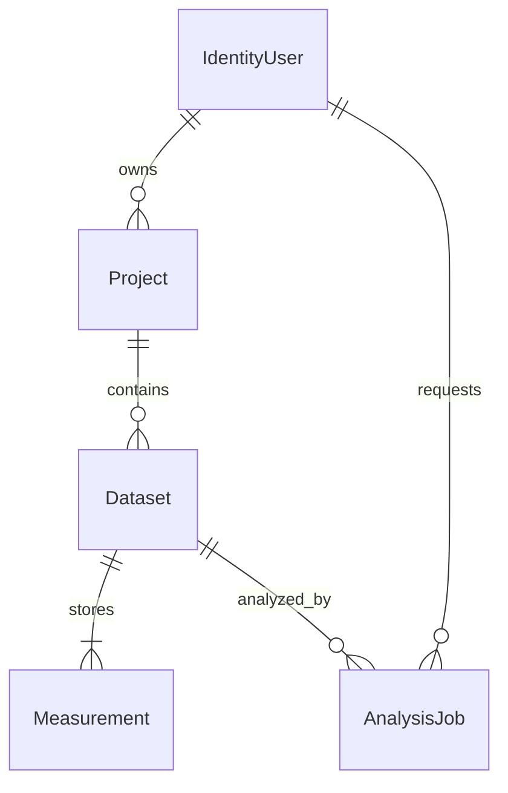
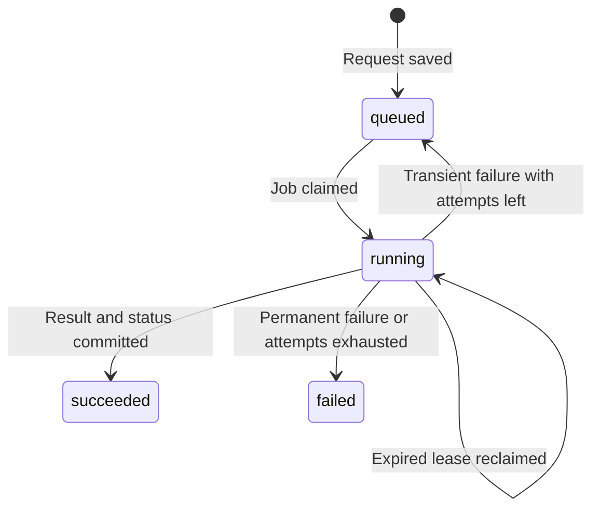

# Architecture

## Application and storage

[Program.cs](../src/MeterFlow.Api/Program.cs) runs the HTTP API and `AnalysisWorker : BackgroundService` in the same process. The API commits an analysis job before returning HTTP 202. The worker later reads that job from PostgreSQL, so processing can continue independently of the request that created it.

The queue is stored alongside the measurements. Restarting the application leaves both the job settings and input data available for another attempt. [JobQueue](../src/MeterFlow.Api/Jobs/JobQueue.cs) also uses PostgreSQL row locks to coordinate workers that try to reserve work at the same time.

The explanations below describe the effects of the current implementation. The repository does not record comparisons of alternative frameworks or queue systems.

| Component | Role in MeterFlow |
| --- | --- |
| ASP.NET Core | Hosts the routes, Identity authentication and background worker. Dependency injection gives each request or worker operation its services. |
| Entity Framework Core and Npgsql | Map C# entities to PostgreSQL tables. EF handles ordinary queries and transactional saves through `AppDbContext`. Npgsql provides the PostgreSQL connection and database-specific error types. |
| PostgreSQL SQL in `JobQueue` | Reserves jobs and checks lease ownership in the same statements that change their state. These operations use parameterized SQL. |
| CsvHelper | Parses CSV fields and quoting. `CsvImport` applies the energy-data rules after parsing each record. |
| Scalar and OpenAPI | Describe the HTTP endpoints and provide an interface for sending requests to the local API. |

The project targets .NET 10 with EF Core 10 and the matching Npgsql provider. [Package references](../src/MeterFlow.Api/MeterFlow.Api.csproj) and [global.json](../global.json) specify the versions. NuGet lock files record resolved dependencies, and CI restores with `--locked-mode`. Framework references include the [.NET support policy](https://dotnet.microsoft.com/en-us/platform/support/policy/dotnet-core) and [Npgsql EF Core 10 release notes](https://www.npgsql.org/efcore/release-notes/10.0.html).

## Data model

[AppDbContext.OnModelCreating](../src/MeterFlow.Api/Data/AppDbContext.cs) defines the relationships and indexes. The [migrations](../src/MeterFlow.Api/Data/Migrations) create that schema. A dataset has no update endpoint, so a later analysis reads the same measurements as an earlier one.

Measurements have a composite primary key, `(DatasetId, BuildingId, Timestamp)`, which prevents two readings for the same building and hour in one dataset. Consumption is stored as `numeric(18,6)` to retain decimal values. Dataset metadata holds the filename, original-byte SHA-256 hash, upload time and row count. The raw CSV is not retained.

An `AnalysisJob` stores its dataset ID, date range and analysis version, plus execution state and result JSON. The unique `(OwnerId, IdempotencyKey)` index prevents concurrent requests from creating separate jobs for the same user's key. Project and dataset indexes include their parent or owner and creation time. The queue index covers status, availability time and creation time.

## Authentication and ownership

[Program.cs](../src/MeterFlow.Api/Program.cs) registers ASP.NET Core Identity and maps its [built-in API endpoints](https://learn.microsoft.com/en-us/aspnet/core/security/authentication/identity-api-authorization?view=aspnetcore-10.0) under `/auth`. Identity handles password hashing, sign-in, lockout and token issuance. The API uses opaque bearer access tokens in Identity's protected token format. They are not JWTs.

Every route under `/api` requires the Identity bearer authentication scheme. The handlers read the user ID from the authenticated `NameIdentifier` claim. Ownership checks depend on the resource:

| Resource | Query condition |
| --- | --- |
| Project | `ProjectEndpoints.MapProjects` filters by the project's `OwnerId`. |
| Dataset | `DatasetEndpoints.MapDatasets` checks the project owner before upload or listing. A dataset lookup checks `Dataset.Project.OwnerId`. |
| New analysis | `JobEndpoints.MapJobs` checks `Dataset.Project.OwnerId` before accepting the request and records the current user as the job owner. |
| Job status or result | `JobEndpoints.Owned` filters by the `OwnerId` stored on the job. CSV export uses this same lookup. |

A resource that belongs to someone else returns 404, as does an unknown ID. A request without valid authentication returns 401.

Data Protection keys, which Identity uses to protect its tokens, are persisted in a separate Compose volume. A restarted API can read those keys and accept previously issued tokens. Development key files are excluded from Git and Docker builds. Storage and account-recovery limitations are listed in [deployment limits](testing.md#deployment-and-maintenance).

## Job acceptance and idempotency

In [JobEndpoints.MapJobs](../src/MeterFlow.Api/Jobs/JobEndpoints.cs), the POST handler validates the key, date range and dataset ownership before it saves anything. It hashes a fixed-format string containing the dataset ID, dates and current analysis version. That hash identifies the settings associated with the key.

Repeating the key with matching settings returns the existing job, even if it has already succeeded. Different settings return 409. When two submissions arrive together, both may initially find no job. The unique index permits only one insert. The other handler catches that specific database conflict, reloads the existing row and compares its hash.

HTTP 202 means the job has been saved or an existing job has been found. It does not mean analysis has finished. The response provides `statusUrl` and `resultUrl`, and the Location header points to the status endpoint.

## Reservation, processing and retries

A lease is a reservation with an expiry time. [JobQueue.Claim](../src/MeterFlow.Api/Jobs/JobQueue.cs) selects an eligible job with `FOR UPDATE SKIP LOCKED`. PostgreSQL locks the selected row and skips rows already locked by another claimant. The same statement changes the selected job to `running`, increments `Attempts` and sets a random `LeaseToken` with a 30-second expiry. The row lock lasts for the statement, while the lease records which worker may continue processing after that lock is released.

[AnalysisWorker.ExecuteAsync](../src/MeterFlow.Api/Jobs/JobProcessor.cs) polls for work, waiting 500 milliseconds when no job is available. Its `Heartbeat` method renews an active lease every 10 seconds. Renewal uses a separate service scope and `DbContext` so it can run while the processor is using its own database context. A failed renewal cancels processing through a cancellation token.

`JobProcessor.Process` checks the stored analysis version, then loads all readings for the dataset and calls `AnalysisCalculator.Calculate`. Loading every reading also identifies buildings with no measurements in the selected period. The import limits bound this load to 50,000 rows.

To finish, `JobQueue.Complete` writes `ResultJson` and `succeeded` in one atomic UPDATE, meaning both changes commit together. The WHERE clause requires a running job, the worker's lease token and an expiry later than the database's current time. This check is called fencing: an old worker cannot publish after it loses its reservation. Repeated completion calls cannot append duplicate results because each job has one result field.

`JobQueue.IsTransient` classifies a `TimeoutException` or an `NpgsqlException` marked transient as eligible for retry. `Fail` requeues such a job if attempts remain, with delays of 2 seconds after attempt one and 4 seconds after attempt two. Other processing exceptions fail the job immediately. Three claims is the limit, including claims made after an interruption. Status responses expose an error code without returning the exception message.

## What happens on restart

| Stored state | Next action |
| --- | --- |
| `queued` | A worker can claim the job once `AvailableAt` has passed. |
| `running`, with an expired lease and fewer than three attempts | A worker claims the job with a new token and recalculates from the stored readings. There is no intermediate calculation checkpoint. |
| `running`, with an expired lease on the third attempt | `Claim` marks it `failed` with `attempts_exhausted`. |
| `succeeded` | The saved result remains available through the API. |

An interrupted calculation may therefore run more than once. An old worker can briefly keep calculating after its lease expires, but its completion UPDATE cannot succeed with an expired or replaced token. The [concurrency tests](../tests/MeterFlow.Tests/JobApiTests.cs) check rejected renewals, completions and failure updates from that old worker.

If the connection drops while publishing, the worker may not know whether its UPDATE committed. PostgreSQL still holds either a completed job or an unfinished job that can be recovered through its lease. Result data and success status cannot commit separately.

Lease checks use PostgreSQL's clock. Initial job timestamps come from the application, so the application and database clocks should be synchronized. `StartedAt` records the most recent claim, and `Attempts` records how many claims have occurred.

## Errors and operational visibility

[ApiExceptionHandler.TryHandleAsync](../src/MeterFlow.Api/Infrastructure/ApiFault.cs) turns application faults into Problem Details, a JSON error format containing status, title and detail. Unexpected errors return a generic message. Responses carry `X-Request-ID`, and Problem Details includes the same identifier as `requestId`.

The request middleware in `Program.cs` logs method, path and response status. Worker logs include job ID and attempt number. The application logging calls use these identifiers and exception types without including authorization headers or CSV contents.

`/health/live` checks whether the API responds. `/health/ready` calls [DatabaseHealth.CheckHealthAsync](../src/MeterFlow.Api/Infrastructure/DatabaseHealth.cs) to test database connectivity. It does not check queue age or worker progress. Job status provides attempts and timestamps for manual inspection.

[compose.yaml](../compose.yaml) keeps PostgreSQL on the internal network and stores data and token keys in named volumes. The API runs as a non-root user. With `Database:MigrateOnStartup` enabled, `Program.cs` applies the committed migrations before serving requests. Further deployment requirements are collected in the [test guide](testing.md#deployment-and-maintenance).
